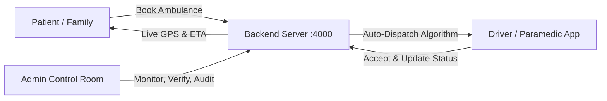

# Ambulance Booking System — User Manual & Operations Guide

An enterprise emergency dispatch and ambulance management platform featuring real-time GPS tracking, automated driver matching, milestone state management, role-based access control, and email verification.

---

## 1. System Overview & Architecture

The Ambulance Booking System connects three primary user roles in an emergency response lifecycle:



### Supported Roles

| Role | Interface | Primary Functions | Default Credentials |
| :--- | :--- | :--- | :--- |
| **Patient (`USER`)** | Mobile App | Request ambulance, track vehicle live on map, settle invoice, rate trip | `adithya@example.in` / `user123` |
| **Driver / Operator (`DRIVER` / `ORG`)** | Mobile App | Set availability status (Online/Offline), accept dispatches, advance trip milestones | `suresh@example.in` / `driver123` |
| **Control Room (`ADMIN`)** | Mobile / Web Dashboard | Live fleet overview, audit logs, provider verification, revenue and response time analytics | `admin@abs.local` / `admin123` |

---

## 2. Server Setup & Configuration

### Prerequisites
- Node.js version 22.5.0 or newer (uses built-in `node:sqlite`)
- Java 17 and Android SDK (for building native APKs)

### Environment Configuration (`backend/.env`)

```env
# Server
PORT=4000
NODE_ENV=development
CORS_ORIGIN=*

# Authentication
JWT_SECRET=your-secure-jwt-secret
JWT_EXPIRES_IN=24h
EXPOSE_OTP_IN_RESPONSE=true

# Email OTP Service (Gmail SMTP)
OTP_CHANNEL=email
EMAIL_PROVIDER=smtp
SMTP_HOST=smtp.gmail.com
SMTP_PORT=465
SMTP_SECURE=true
SMTP_USER=devjipatelop@gmail.com
SMTP_PASS=ravgiolawvhaiajj
EMAIL_FROM="Ambulance Booking System <devjipatelop@gmail.com>"

# Dispatch & Watchdog
OFFER_TIMEOUT_SECONDS=45
MAX_DISPATCH_RETRIES=5
SEARCH_RADIUS_KM=15
WATCHDOG_ENABLED=true
WATCHDOG_INTERVAL_SECONDS=60
```

### Starting the Server

```bash
cd backend

# Seed the database with demo accounts & ambulances
npm run seed

# Start server in development mode (auto-reload)
npm run dev
```

The server listens on `http://localhost:4000`. You can verify system health at:
👉 `http://localhost:4000/health`

---

## 3. Mobile App (Android APK)

### Connecting the App to the Backend
A packaged APK cannot reach `localhost` because on a mobile device `localhost` refers to the phone itself. 

1. Ensure your phone and laptop are on the same Wi-Fi or mobile hotspot.
2. Find your laptop's IP address (`ifconfig` or Wi-Fi settings, e.g. `10.71.19.230`).
3. Open the installed app on your phone.
4. At the bottom of the sign-in screen, tap **`Backend: ... [Change]`**.
5. Enter your laptop's IP and port:
   ```
   10.71.19.230:4000
   ```
6. Tap **Save**. The app connects immediately.

---

## 4. User Walkthroughs

### 4.1 Patient / Family User Guide

1. **Passwordless Sign In & Registration**:
   - Select **"Book an ambulance"** mode.
   - **New User**: Tap **Register**, enter your name and email, tap **Send verification code**, check your inbox or spam for the 6-digit code, and tap **Verify & Create Account**. No password required!
   - **Existing User**: On **Sign in**, enter your email, tap **Send verification code**, and enter the 6-digit code to log in.
2. **Booking an Ambulance**:
   - Select ambulance category:
     - **BLS (Basic Life Support)**: Oxygen, stretcher, paramedic.
     - **ALS (Advanced Life Support)**: Ventilator, defibrillator, intensive care paramedic.
     - **ICU (Mobile Intensive Care Unit)**: Full cardiac and critical life support.
     - **PTV (Patient Transport Vehicle)**: Non-emergency transfer between facilities.
   - Enter your pickup address or tap **Use current location**.
   - Tap **Request Ambulance**.
3. **Live Tracking & In-App Voice Calling**:
   - The system automatically searches for the nearest on-duty driver within 15 km.
   - Once a driver accepts, you see their vehicle number, driver name, live GPS movement, and real-time ETA.
   - **In-App Voice Call**: Tap **`🎙️ In-App Voice Call`** on the driver card to speak directly with the driver through the app over encrypted VoIP (no cellular minutes used, no personal phone numbers exposed).
   - Alternatively, tap **`Direct Phone Call`** if you prefer using your phone's native SIM dialer.
4. **Completion & Payment**:
   - When the ambulance reaches the hospital, the trip completes.
   - An itemized invoice is calculated from the actual patient-onboard distance driven.
   - Pay via UPI, Card, Netbanking, or Cash, and rate your driver (1 to 5 stars).

---

### 4.2 Ambulance Driver Guide

1. **Passwordless Sign In & Registration**:
   - Select **"Drive an ambulance"** mode.
   - **New Driver**: Tap **Register**, pick **Individual driver** or **Organisation**, enter details, verify via email OTP, and submit your registration.
   - **Existing Driver**: On **Sign in**, enter your driver email (e.g. `suresh@example.in`), tap **Send verification code**, enter the code, and tap **Verify & Sign In**. No passwords needed.
2. **Duty Status**:
   - Toggle your status to **Available (Online)**.
   - The app begins reporting background GPS coordinates every 20 seconds.
3. **Accepting Emergency Dispatches & Contacting Booker**:
   - When a patient nearby requests an ambulance, an emergency card appears with patient details, pickup location, distance, and a **45-second countdown timer**.
   - Tap **Accept Request**.
   - **In-App Voice Call**: Tap **`🎙️ In-App Voice Call`** on the patient card to speak to the booker inside the app with full mute controls and call duration timer.
4. **Milestone Progression**:
   Advance the trip strictly in order using the one-touch action button:
   - `Start driving to pickup` ➔ Sets status to **ENROUTE**.
   - `I have arrived` ➔ Sets status to **ARRIVED**.
   - `Patient is on board` ➔ Sets status to **ONBOARD** (GPS odometer begins calculating billing distance).
   - `Complete the trip` ➔ Sets status to **COMPLETED** and releases you back on duty.

---

### 4.3 Control Room Administrator Guide

1. **Sign In**:
   - Select **"Control room"** mode.
   - Credentials: `admin@abs.local` / `admin123`.
2. **Real-Time Overview**:
   - Monitor active trips, unassigned requests, and on-duty ambulance units.
3. **Fleet & Provider Verification**:
   - View newly registered drivers and hospital vehicles.
   - Verify documents or suspend vehicles if inspection is overdue.
4. **Reports & Analytics**:
   - **Response Time**: Average minutes from booking creation to arrival.
   - **Demand Heatmaps**: Peak booking volume grouped by local time hours.
   - **Revenue**: Base fare, distance surcharge, and tax breakdown.
5. **Audit Trail**:
   - Immutable record of every login, OTP request, dispatch offer, and status update for compliance.

---

## 5. Troubleshooting & FAQ

| Problem | Cause | Solution |
| :--- | :--- | :--- |
| **"Cannot connect to backend"** in app | Phone is looking for `localhost` or wrong IP | Tap **Change** at bottom of login screen and set laptop IP (e.g. `10.71.19.230:4000`). |
| **OTP email not arriving** | Gmail spam filter or incorrect email | Check Gmail **Spam** folder. Verify `SMTP_USER` and `SMTP_PASS` in `backend/.env`. |
| **Driver not receiving booking offer** | Driver status is Offline or location > 15 km away | Toggle driver to **Available** and ensure GPS permission is granted. |
| **Resetting to clean state** | Test data clutter | Run `npm run seed -- --reset` in `backend/` to wipe and restore fresh demo fleet. |
